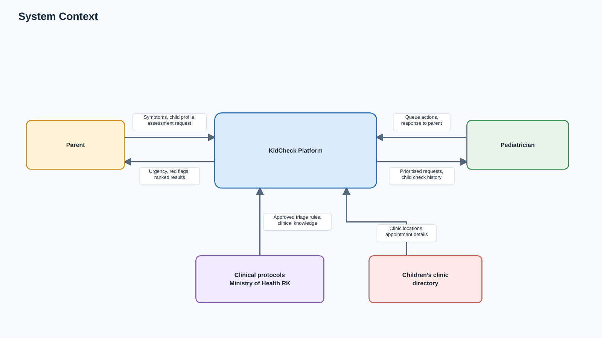
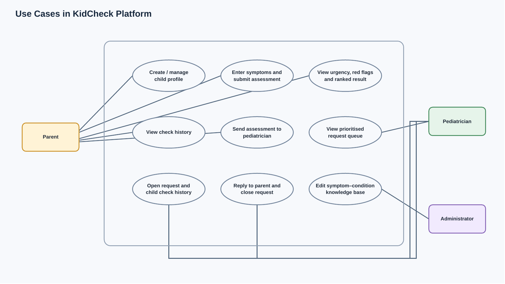
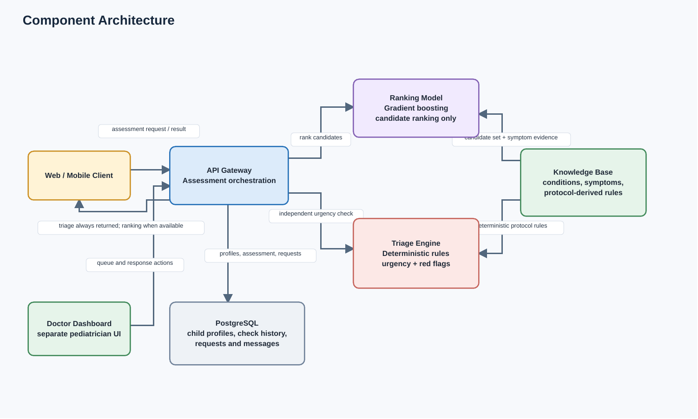

# Architecture

## 1. Overview

KidCheck is a preliminary assessment platform for parents and pediatricians. A parent records a child's profile and symptoms, then receives a ranked list of possible conditions, a deterministic urgency level, and red-flag warnings. A pediatrician can review requests in a prioritised queue and reply to the parent. The platform supports clinical decision-making; it does not diagnose, prescribe treatment, or replace a clinician.

The selected implementation is a modular monolith: one FastAPI application with explicit internal boundaries for assessment, triage, persistence, and the ranking model. The model ranks candidates, while the triage engine independently evaluates protocol-derived urgency rules. This keeps the emergency guidance path available when ranking is unavailable.

## 2. System context

The platform receives symptom and child-profile data from parents, returns the assessment, and supports follow-up by pediatricians. Clinical protocols from the Ministry of Health of the Republic of Kazakhstan inform the knowledge base and triage rules. A clinic directory supplies locations and appointment details when that integration is available.

## 3. Use cases

The parent manages child profiles, submits symptoms, reviews an assessment and check history, and can send a check to a pediatrician. The pediatrician reviews prioritised requests, opens a case with its history, replies to the parent, and closes the request. An administrator maintains the symptom–condition knowledge base.

## 4. Component architecture

The web or mobile client and the separate doctor dashboard call the API Gateway. The gateway coordinates persistence and the two assessment components. The Knowledge Base supplies candidate conditions and symptom evidence to the Ranking Model, and protocol-derived rules to the Triage Engine. PostgreSQL stores child profiles, check history, requests, and messages.

## 5. Separation of ranking and triage

The Ranking Model and Triage Engine solve different problems and do not depend on one another. The Ranking Model uses the knowledge base to form a candidate set and explain matching or absent symptoms; the gradient-boosting model reorders those candidates by likelihood. It does not assign urgency.

The Triage Engine applies deterministic rules derived from approved clinical protocols to the reported symptoms, age, and other required inputs. It returns exactly one of four urgency levels and the red-flag block independently of the ranked conditions. The gateway returns triage and red flags even if ranking fails, along with a notice that the ranked list is unavailable. The assessment must not imply that a missing ranking means the child is safe.

## 6. Data flow of one assessment

1. The parent selects a child profile, enters symptoms and duration, provides a temperature when applicable, and submits the assessment.
2. The API Gateway validates the request and stores the submitted check in PostgreSQL.
3. The gateway passes the same validated inputs to the Triage Engine and the Ranking Model independently.
4. The Triage Engine evaluates deterministic rules and returns urgency plus red flags. The Ranking Model builds candidates from the Knowledge Base and reorders them; the Knowledge Base provides matching and missing symptom evidence.
5. The gateway combines the available outputs, stores the result, and returns it to the client with the non-diagnosis notice. If ranking fails, it returns the triage output and an explicit ranking-unavailable notice.
6. If the parent requests follow-up, the request appears in the pediatrician dashboard's queue. The pediatrician can review the assessment and prior checks, reply, and close the request.

## 7. Technology mapping

The implementation choices and their rationale are recorded in [Technology Comparison](05-technology-comparison.md): FastAPI (Python) for the backend, PostgreSQL for data storage, a knowledge base plus gradient boosting for hybrid ranking, React for the frontend, and a modular monolith with an internal model service boundary for component interaction.

## 8. Diagram sources

Editable diagrams.net sources are stored alongside their PNG exports:

- [System context source](../diagrams/src/01-system-context.drawio)
- [Use case source](../diagrams/src/02-use-case.drawio)
- [Component source](../diagrams/src/03-component.drawio)
